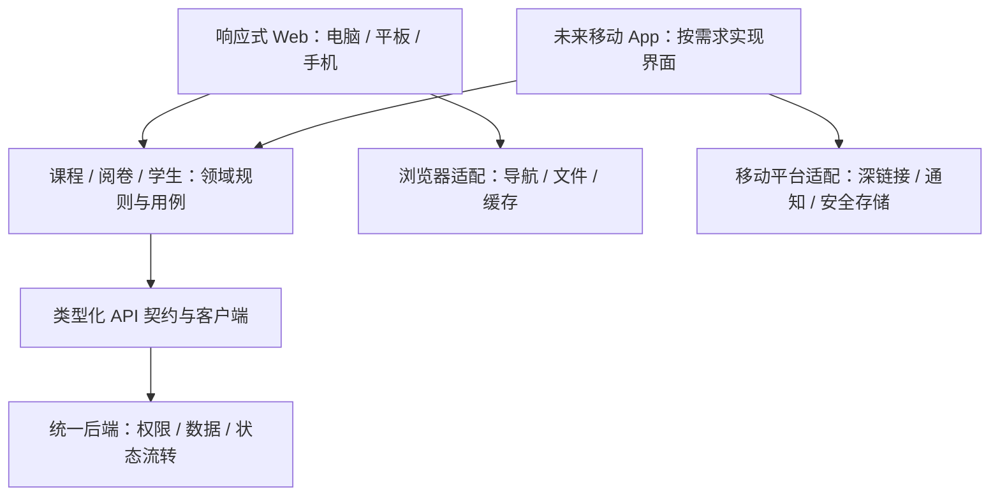

# 教师端整体响应式设计方案

日期：2026-09-27  
状态：设计方案；教师端首期响应式布局与核心阅卷闭环已实施，并完成模拟数据浏览器验收。真机与真实后端数据仍需验证。  
规划假设：手机首期优先日常轻办公、课堂查询和快速阅卷；电脑保留完整备课与管理能力；平板支持连续阅卷。此优先级尚未由用户确认。

## 1. 总体决策

采用“统一业务与信息架构、按可用空间调整布局、按任务复杂度调整操作流程”的方案。

- 四个一级模块保持一致：工作台、我的课程、阅卷中心、学生管理。
- 响应式 Web 是第一交付形态。未来独立移动端复用业务契约与领域逻辑，不以复制页面实现独立。
- 手机核心闭环为：发现待办 → 进入具体课程或答卷 → 完成操作 → 获得可靠结果 → 回到原上下文。
- 电脑保留高密度表格、多栏对照、批量操作；手机采用列表、详情与专注操作页；平板按空间使用双栏。
- 不因本轮响应式改造新增 Course 数据模型、拆后端服务或整体迁移技术栈。

## 2. 当前系统基础与改造重点

| 已核对的现状 | 对方案的影响 |
| --- | --- |
| React 19、Tailwind 4、Radix/shadcn、React Router，已有 viewport hook | 沿用技术栈和组件体系，统一响应式规则 |
| 教师 Layout 已有窄屏抽屉菜单；学生管理由工作台入口进入，未列入教师主导航 | 补全四模块导航，手机一级入口常驻底部 |
| 课程详情包含目录、资料、考试、练习、题目、试卷、统计、管理，使用固定 256px 侧栏 | 将八个功能按教师任务组织，保留功能映射和深链接，手机不直接压缩侧栏 |
| 阅卷已支持按题、按学生及整卷视图，包含多栏与内部滚动 | 复用评分行为，为手机设计顺序操作视图 |
| 学生管理使用班级侧栏、数据表格及部分 hover 操作 | 班级变为可搜索选择器，学生变为紧凑列表，提供常显操作入口 |
| 课程详情约 7,900 行、阅卷中心约 2,700 行 | 按改造模块逐步分离数据、业务状态、视图，避免继续叠加屏幕分支 |
| 已有 PWA manifest、Service Worker 与静态资源预缓存 | 可作为安装体验基础；目前不能据此宣称支持离线阅卷或跨设备草稿 |
| 学生名单接口按班级返回列表，前端执行搜索；阅卷存在前端组装学生题目矩阵的逻辑 | 数据量增大时补服务端分页、搜索、摘要接口，不能只减小视觉体积 |

代码依据：

- `frontend/src/components/layout.tsx`
- `frontend/src/pages/dashboard.tsx`
- `frontend/src/pages/courses/detail.tsx`
- `frontend/src/pages/grading/index.tsx`
- `frontend/src/pages/students/index.tsx`
- `frontend/src/hooks/use-viewport.ts`
- `frontend/src/sw.ts`、`frontend/vite.config.ts`
- `backend/src/app/teacher_courses/router.py`
- `backend/src/app/rbac/students_router.py`

历史设计文档用于理解领域，当前行为以代码为准。下文新增的页面结构、状态契约及接口要求均为建议，不表示已经具备。

## 3. 功能划分与归属

| 一级模块 | 教师要完成的事 | 职责边界 |
| --- | --- | --- |
| 工作台 | 知道今天要做什么，继续未完成工作 | 聚合待办和最近访问；点击进入原模块，不独立实现第二套业务 |
| 我的课程 | 围绕某门课程组织教学 | 课程内容、练习与考试、资料与题目、课程内成绩、学期与班级关联 |
| 阅卷中心 | 连续处理不同课程的评分任务 | 跨课程队列、人工评分、AI 结果复核、异常处理；课程内“去批改”进入同一实现 |
| 学生管理 | 找到学生，维护学生及班级关系 | 当前教师有权访问的学生主档案、班级、关联与账号操作；课程成绩仍有课程范围 |

课程内的“学生”是选学该课程的学生及其课程表现；全局学生管理是学生档案和班级关系。同一学生使用相同 ID，不能因不同入口创建两份档案。

建议把课程内八个功能整理为五组，两端使用相同名称和归属：

| 课程内分组 | 包含内容 | 当前功能映射 |
| --- | --- | --- |
| 概览 | 当前学期、待办、最近教学活动 | 聚合现有课程与待办数据 |
| 教学 | 考试、练习及提交进度 | exams、assignments |
| 资源 | 目录、资料、题目、试卷 | knowledge、materials、questions、papers |
| 学情 | 学生成绩、知识掌握情况 | statistics |
| 管理 | 学期、班级关联、成绩权重、课程设置 | manage 与学期操作 |

电脑左侧展示分组及子项；手机课程首页提供相同五组的清晰入口，进入后为独立列表/详情页。资源下二级导航优先用页面标题旁的选择器，避免同时堆叠两行 Tab。

第一步可以保留现有八个功能名称，只调整布局；五组重整在下一阶段两端同步上线，避免手机和电脑形成两套分类。

## 4. 首期能力矩阵

“手机后续完善”代表明确的分期范围，不是永久禁止。所有核心查询、单项处理必须在手机形成闭环；未完成的重编辑能力保留可发现入口、原因与转到电脑的方式，不能展示坏掉的桌面页。

| 能力 | 电脑 | 平板 | 手机首期 |
| --- | --- | --- | --- |
| 待办、最近课程、继续阅卷 | 完整 | 完整 | 优先、完整 |
| 课程列表、课程详情、资料阅读 | 完整 | 完整 | 完整；复杂原文件提供预览/下载路径 |
| 查看考试与练习、提交进度 | 完整 | 完整 | 完整 |
| 复用已有试卷发布教学任务 | 完整 | 分步表单 | 核对对象、时间、规则后确认；可排在基础查询之后 |
| 单题评分、AI 评分复核 | 完整 | 重点优化 | 优先、完整 |
| 按学生阅整卷 | 多栏 | 双栏 | 可逐题阅读和评分；不要求同时显示整卷 |
| 长代码、长文与多附件对照 | 完整 | 重点优化 | 支持阅读与逐项查看；效率优化后续完善 |
| 查学生、查班级、单项账号操作 | 完整 | 完整 | 完整，受同一权限控制 |
| 新建/关联单个学生 | 完整 | 完整 | 简短全屏表单 |
| 批量名单导入、错误行修复 | 完整 | 完整 | 首期不主推，查看任务结果；导入向导后续完善 |
| 课程目录重排、复杂题目编辑、组卷 | 完整 | 按空间提供完整编辑 | 首期查看与轻量修改；重编辑后续专门设计 |
| 成绩明细与分析 | 全量表格、对比 | 表格与详情 | 关键指标、学生明细；原始表格局部横向滚动 |

发布考试、关闭考试、重置密码、移除关联等操作不按屏幕大小改变权限。展示对象、影响范围及必要的确认信息；不为普通查看增加确认。

## 5. 导航与页面布局

### 5.1 统一导航

电脑保留现有顶部导航，补齐学生管理，无须为了响应式另起全局侧栏。课程详情可继续拥有局部侧栏。

手机底部固定四项：`工作台 / 课程 / 阅卷 / 学生`。页面标题显示完整名称。账号、设置和退出集中到右上角头像，通知保留独立入口，不新增第五个“我的”占位。

- 一级列表与普通详情保留底部导航，明确当前所属模块。
- 阅卷、长表单、资源编辑进入专注页：隐藏底部导航，顶部显示返回与对象，底部只留当前任务操作。
- 弹层先关闭，详情再返回列表；从外部深链接进入时，返回有确定的父页面兜底。
- 从课程进入阅卷保留课程、学期、考试范围；返回恢复原列表位置和筛选。
- 首页是教师待办中心，不因手机新增另一个独立首页。

### 5.2 初始布局区间

以下为实施起点，需由真实内容撑开情况校准，不能当成设备型号判断。

| 可用宽度 | 建议布局 | 导航 |
| --- | --- | --- |
| 小于 768 CSS px | 单栏；列表 → 详情 → 操作 | 四项底栏 |
| 768–1199 CSS px | 单/双栏自适应；辅助列表可收起 | 顶部四项；课程局部导航可折叠 |
| 不小于 1200 CSS px | 完整工作区，空间充足时三栏阅卷 | 顶部四项 + 必要的局部侧栏 |

宽度决定布局；指针精度和 hover 能力决定点击区与交互提示。平板分屏仍可能进入单栏；触屏笔记本仍需提供触摸操作。保留现有学生端专用 `useIsMobile` 行为，新教师布局语义单独设计，避免全局修改引发学生端回归。

普通内容使用受控行宽；成绩表和阅卷工作区利用可用宽度。组件在侧栏、抽屉、全页等不同容器中复用时，可用容器查询判断自身布局，而非到处读取屏幕宽度。[MDN：容器查询](https://developer.mozilla.org/en-US/docs/Web/CSS/Guides/Containment/Container_queries)

### 5.3 手机示意

```text
工作台                          通知 头像
待处理
数据结构 · 练习二        12 份待阅 >
数据库 · 阶段考试        查看提交 >

继续上次阅卷                      >
最近课程
数据结构                 本学期  >
数据库                   本学期  >

工作台        课程        阅卷        学生
```

示意数字仅说明布局，不是系统真实数据。真实页面中，有进行中的阅卷时把“继续上次阅卷”放在待办上方。统计数量不使用抢眼大卡片，优先让教师直接找到下一步。

## 6. 四模块具体交互

### 6.1 工作台

内容顺序为：进行中的任务 → 待处理事项 → 最近课程 → 次要统计。

待办每行显示对象、必要时间/状态、数量与唯一去向；按紧急程度和最近活动排列。计数单位明确区分“份答卷”“道待评答案”“场考试”，避免同一“待阅卷”在不同页面数字口径不同。

空状态显示“暂无待办”及现有课程入口；无课程时显示创建课程入口。刷新失败保留已加载内容并提示重试。教师入口均落到课程或阅卷上下文，逐步收口工作台中仍指向独立题库、考试管理的旧入口。

### 6.2 我的课程

- 课程列表：电脑可沿用卡片；手机为紧凑行，显示课程名、学期/范围、待办摘要。课程名允许两行，次要统计进入详情。
- 课程头部：课程名、学期选择器、低强调“更多”；当前学期始终可辨。只读/已归档状态清楚，但不占据大块空间。
- 考试/练习列表：优先显示名称、状态、截止时间、提交数；进入详情后进行修改或发布。
- 资料与题目：手机提供搜索、筛选、列表、阅读详情；长公式/代码在局部容器滚动，图片可放大。
- 目录：分级列表加当前位置，提供点击式移动选择，不能要求拖拽才可完成操作。
- 教学发布：选择已有内容 → 选择当前学期与班级 → 时间/规则 → 复核发布。可携带上下文的步骤自动填入，仍显示关键对象供核对。
- 成绩：手机先选班级或学生，再看该范围明细；完整成绩矩阵可局部横向滚动，不横向推动整个页面。

### 6.3 阅卷中心

电脑：任务/学生列表、作答内容、评分区按空间并列。平板：作答与评分双栏，队列收起。手机：队列 → 当前作答 → 确认评分 → 下一项；保留按题与按学生模式，默认延续上次选择。

从待办或课程进入时直接定位目标任务，已有上下文不再要求重新选择课程和考试。

```text
← 返回队列      练习二 · 第 3 题       5/12
学生：张同学                    切换学生
题干摘要                         展开
学生作答
……
参考答案 / 评分依据                展开
AI 建议分（如有）                 查看依据
人工评分                         [ 8 ] / 10
评语                             [       ]
保存状态
上一项                         确认并下一项
```

评分输入和必要评分依据应可直接访问；不把整个评分流程藏在反复开合的底部抽屉中。底部操作条保持精简，键盘弹起后不能遮住正在输入的字段。附件、完整题干和参考答案可临时展开或全屏查看。

明确区分三类状态：

1. 业务状态：待人工处理、AI 建议、已确认等，映射现有后端真实状态。
2. 草稿状态：未修改、未保存、已保存；若首期没有服务端草稿，必须明确只能保留当前设备的临时修改。
3. 请求状态：提交中、成功、失败、结果待核实。网络失败不能假装评分已完成。

“确认并下一项”先保存并确认服务端结果，再前往下一项；失败停留当前答案并保留输入。连续点击不重复提交，评分范围在前后端校验。请求超时但可能已落库时，先核对结果再重试。跨设备同时改分需要版本检测/冲突提示，不能用最后一次写入静默覆盖。

切换题目、学生、设备方向不丢失未提交内容。只读缓存可后续增加；首期离线不提交最终分数，恢复连接后重新核对服务端状态。

### 6.4 学生管理

- 电脑保留班级侧栏与表格；手机头部是可搜索班级选择器，下方是学生搜索与列表。
- 列表显示姓名、学号/编号、班级及必要状态；账号和管理操作放到详情。
- 学生详情展示档案和当前教师有权访问的教学记录；不会因进入全局学生页而扩大数据范围。
- 添加/关联学生使用独立短表单，复用已有学生主档案规则。
- 批量操作必须显式进入“选择”模式；选择数量与范围可见。切换筛选时明确保留还是清空选择，不采用隐藏的跨筛选批量删除。
- 清楚区分移出班级、解除本教师关联、删除账号。具体按钮文案必须匹配后端真实效果，不能将三个动作都叫“删除学生”。
- 名单导入后续提供文件选择、校验摘要、错误行下载/修正、确认导入流程；后台继续的任务需可重新进入查看结果。

## 7. 统一组件与可操作性规范

优先沉淀五类常用模式，随后按真实复用需求扩展：

| 模式 | 电脑 | 手机 |
| --- | --- | --- |
| 列表/详情 | 表格、分栏详情 | 紧凑列表、路由详情 |
| 筛选 | 工具栏 | 常用筛选直接可见，其余集中筛选面板 |
| 短操作 | Popover/Dialog | 低高度底部面板或 Dialog |
| 长表单/编辑 | 独立页面或工作区 | 独立全屏页，避免多层弹窗 |
| 上下文操作 | hover 可作辅助 | 常显“更多”入口，功能不依赖 hover |

视觉沿用项目的克制规范：一处主要操作、轻分隔、清晰状态，使用现有 Lucide 通用图标。触屏主要点击区建议约 44×44 CSS px，图标本体仍保持常规大小；不是所有控件都放大成粗重按钮。WCAG 2.2 AA 的最小目标要求为 24×24 CSS px，并有间距等例外，44px 是本方案的触屏体验目标。[W3C：Target Size](https://www.w3.org/WAI/WCAG22/Understanding/target-size-minimum.html)

普通内容在 320 CSS px 宽度下可重排；表格、代码、公式等确需二维表达的内容，只在自身区域横向滚动，不把整页变成横向画布。[W3C：Reflow](https://www.w3.org/WAI/WCAG22/Understanding/reflow.html)

每页指定一个主要滚动容器。手机避免父页面与多块内容同时抢滚动；使用动态视口高度并处理底部安全区、虚拟键盘。固定操作条需要等高内容留白，最后一项不能被挡住。字体允许系统放大，不能禁用页面缩放。

弹层遵守焦点进入、关闭后返回触发点、键盘可操作规则。错误指向具体字段，失败提供明确重试，不能只有瞬时 toast。保存成功后原列表、工作台计数与课程待办同步失效刷新。

沿用项目 PageIntroHeader 规则：sticky 使用 embedded 与 `ml-[calc(50%-50vw)] w-screen`，不使用 fullBleed。

## 8. 可维护的实现边界



### 8.1 三种变化分别处理

1. 排列变化：通过 CSS Grid/Flex/媒体查询/容器查询实现，如卡片列数、工具栏换行。
2. 视图结构变化：在模块边界选择 Desktop/Compact 视图，如表格与手机列表、三栏阅卷与逐项阅卷。
3. 业务逻辑：数据加载、权限判断、校验、评分提交共享，不放进屏幕判断分支。

不要同时挂载两套编辑器再用 CSS 隐藏一套，避免重复请求、隐藏焦点和双份草稿状态。共享控制器负责状态；模式切换仅替换视图。也不追求所有 UI 都共享，同一份业务数据可以有两个小型展示组件。

第一阶段在现有 frontend 内按 `features/courses`、`features/grading`、`features/students` 逐步整理；新增 teacher shell 与响应式组件集中存放。保留路由页作为入口，不要求一次搬走全部代码。第二个客户端真实启动时，再把稳定的领域逻辑、API 契约提取为独立包，不预先建立庞大的 monorepo。

继续复用当前数据获取体系。无须仅为响应式引入一套新的状态库、UI 库或移动端框架。

### 8.2 URL、状态与路由

沿用 `/dashboard`、`/courses`、`/grading`、`/students`，同一资源由同一 URL 表达。不要建立整套平行 `/mobile/*` 业务路由。

- URL：课程/考试/任务 ID、学期、分组、筛选、分页；适合刷新、分享、外部通知进入。
- 服务端数据缓存：列表、详情、待办计数，缓存键包含角色/组织及业务范围。
- 本地 UI 状态：展开项、临时弹层、滚动位置。
- 草稿：独立于布局的表单状态；跨设备恢复需要服务端持久化，不能仅靠 localStorage。

当前阅卷已有 examId 与返回上下文参数，可继续扩展到具体任务；课程功能部分依赖组件 state，需逐步补可恢复的 URL 状态。返回来源优先路由上下文，直接访问仍应有确定父级。

Layout 逐步使用显式页面布局类型（普通列表、详情、专注任务），减少根据大量 pathname 特判来决定高度、滚动和导航的方式。教师 shell 的调整须隔离 evaluator、管理员和学生端现有行为。

### 8.3 接口与性能

先复用现有接口，只对被验证的瓶颈补能力：

- 手机列表返回摘要，详情按需取；名单与阅卷队列支持服务端搜索/分页。
- 当前答案、下一项和评分依据按需加载，不为手机首屏预取全考试所有学生的题目矩阵。
- 文件解析、批量生成、导出等长操作有任务 ID、进度与结果，可离开后重新进入。
- 评分写入具备防重复与并发版本检查；异步任务状态从服务端恢复。
- 桌面与手机采用同一权限模型。后端校验对象范围，屏幕大小从不参与授权。
- PDF、Monaco、富文本及导入解析依赖按路由/操作加载；不让工作台支付编辑器成本。

具体聚合 API 或 BFF 只在请求数量/首屏等待确有问题时引入，不为未来移动端提前复制后端业务。

## 9. 独立移动端演进

独立发布、独立导航体验、原生渲染是三个不同决定，不需要同时发生。

| 阶段/方案 | 适用条件 | 复用与代价 |
| --- | --- | --- |
| 响应式 Web，完善 PWA | 当前阶段；链接访问和安装到主屏已满足需求 | 复用现有界面；安装、通知等需按目标平台验证；PWA 不自动提供业务离线能力 |
| 独立移动入口/构建，必要时使用 Capacitor | 需要应用分发、相机、分享、平台通知等，Web 交互仍能满足核心任务 | 较多复用 Web UI；仍需处理权限、键盘、安全区、生命周期、登录与更新 |
| 单独原生/跨平台原生 UI | 持续出现高强度手写批注、复杂离线同步或原生交互诉求 | 复用 API 和适合平台无关实现的业务规则；DOM/Radix/Tailwind 界面需要重新实现 |

Capacitor 官方定位为可接入现有现代 Web 应用的跨平台原生运行时，并提供原生能力桥接；这只能说明有可行演进路径，不能保证包装后就有良好移动体验。[Capacitor 文档](https://capacitorjs.com/docs)

当前应做好模块边界、可定位任务的深链接、请求状态、可恢复草稿及平台能力入口。只有某项平台能力开始跨端使用时才抽象适配器，不提前包装每一个浏览器 API。真实开发独立 App 时再选择登录凭据存储和登录回跳策略，不能直接搬用浏览器 localStorage 假设。

## 10. 分阶段实施与验收

每个阶段交付可使用的完整链路，按模块开关/小范围试用回退，不要求一次替换全部教师端。

| 阶段 | 交付内容 | 通过条件 |
| --- | --- | --- |
| A：基础导航与查询 | 教师四入口、响应式 shell、工作台、课程/学生列表、普通详情、返回与滚动规范 | 手机可从四入口完成查课程、查学生、看任务；原桌面路径可用；无整页横向溢出 |
| B：阅卷核心闭环 | 队列、具体答案、评分、失败重试、确认后下一项、返回恢复 | 真机完成一组连续阅卷；弱网不误报成功；旋转/返回不丢输入；服务端结果与计数一致 |
| C：课程与管理操作 | 课程分组两端同步、资料阅读、复用发布、轻量编辑、学生单项管理、成绩明细 | 当前课程/学期/班级范围不丢失；发布对象明确；相同权限在各端一致 |
| D：重编辑与移动平台 | 导入修复、复杂编辑、可恢复后台任务；按需求评估独立 App | 以实际任务成功率、完成时间、失败恢复表现决定投入 |

实施中按项目验证分级：纯页面布局微调 L0；单页逻辑 L1；共享 shell、业务状态或接口变化 L2。L2 按项目本地验证流程使用自己的 4100/8100 端口，只走受影响主流程。没有用户明确要求，不跑全量回归。

首批验收使用代表性数据：长课程名、多班级、长题干、公式/代码/图片答案、大量学生、只读课程、无待办、权限失效、提交失败。

响应式抽查宽度：320、390、768、1024、1440 CSS px；另外检查手机横屏、平板分屏、文字放大、虚拟键盘、iOS Safari 与 Android Chrome 真机。尺寸抽查不等同每个功能都做五套端到端测试，主流程选择代表性组合。

发布前的核心验收场景：

1. 工作台待办 → 定位答案 → 确认评分 → 下一项 → 返回后数量与列表位置正确。
2. 我的课程 → 当前学期练习 → 提交进度 → 对应学生答卷，返回不丢筛选。
3. 学生管理 → 班级/姓名搜索 → 学生详情 → 单项操作 → 原列表状态更新。
4. 在电脑打开手机保存的业务链接，定位相同对象；切换视图不重建业务草稿。
5. 模拟保存超时、服务器失败和多端冲突，输入保留、结果明确且可恢复。

## 11. 落地范围与后续需要验证的假设

首期已在现有 React 应用中实现教师四入口、任务型工作台、课程与学生页的窄屏布局，以及手机和平板阅卷流程；具体实施任务和验证记录见[实施任务](./2026-09-27-teacher-responsive-implementation.md)。C 阶段中的五组课程功能重整、完整发布向导，以及 D 阶段的复杂编辑和独立 App 均未实施。服务端持久草稿、分页摘要接口及多端评分版本冲突检测仍属于后续接口工作，不能把本机临时记录当作跨设备同步。

目前的页面验收使用独立 4100/8100 端口和模拟教师数据；这能验证页面布局与操作路径，不能代替真实数据库、真机键盘和弱网环境的验收。

后续原型/试用优先验证：手机教师最常见的前三项任务、按题/按学生阅卷占比、是否需要长文/代码频繁对照、典型班级规模、独立 App 的具体动因。优先级会影响分期，四模块归属与业务共享边界可先稳定下来。
